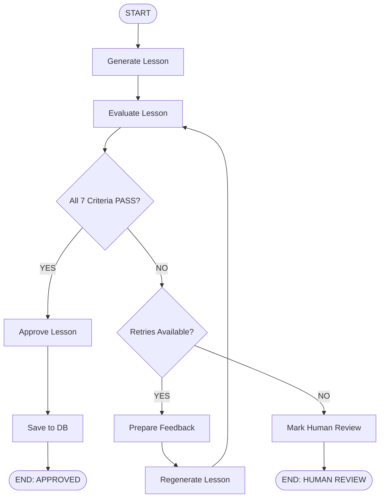

# 🎓 AI Lesson Studio

> **Self-Evaluating AI Lesson Content Generator**  
> *Generate. Evaluate. Improve. Publish.*

A production-grade GenAI agentic system that generates beginner-friendly educational lessons, independently evaluates them against a strict 7-criterion rubric, automatically regenerates failing content with targeted feedback, maintains persistent memory across sessions, and self-improves based on historical failure patterns.

---

## 📋 Table of Contents

1. [Project Overview](#-project-overview)
2. [Problem Statement](#-problem-statement)
3. [Project Objectives](#-project-objectives)
4. [Features](#-features)
5. [Technology Stack](#️-technology-stack)
6. [System Architecture](#️-system-architecture)
7. [Agent Workflow](#-agent-workflow)
8. [Evaluation Rubric](#-evaluation-rubric)
9. [Retry Mechanism](#-retry-mechanism)
10. [Persistent Memory](#-persistent-memory)
11. [Self-Improvement Mechanism](#-self-improvement-mechanism)
12. [Project Directory Structure](#-project-directory-structure)
13. [Installation](#-installation)
14. [Environment Setup](#️-environment-setup)
15. [Running the Application](#-running-the-application)
16. [Running Tests](#-running-tests)
17. [Evaluator Stress Test](#-evaluator-stress-test)
18. [Example Outputs](#-example-outputs)
19. [Design Decisions](#-design-decisions)
20. [Limitations and Future Improvements](#-limitations-and-future-improvements)
21. [GitHub Publishing](#-github-publishing)
22. [Loom Demo Script](#-loom-demo-script)

---

## 📖 Project Overview

The AI Lesson Studio is an intelligent, agentic AI application designed for the GenAI Engineer – Content Systems assessment. It demonstrates advanced agentic design patterns including:

- **Multi-agent architecture** with separate, independent generator and evaluator agents.
- **LangGraph workflow orchestration** with conditional branching and retry loops.
- **Self-correcting content generation** with evaluator feedback driving regeneration.
- **Persistent memory** using SQLite to learn from failure patterns across sessions.
- **Transparent self-improvement** that updates generator prompts without touching the rubric.

---

## 🎯 Problem Statement

Traditional AI content generators produce output without quality assurance. If generated content is technically inaccurate, too complex for beginners, or incomplete, there is no mechanism to detect and correct the problem automatically.

This project solves that problem by building a **closed-loop quality assurance system** where:
- An independent evaluator agent checks every piece of generated content.
- Failed content is automatically improved and re-evaluated.
- The system learns from repeated failures to produce better content over time.

---

## 🚀 Project Objectives

- [x] Accept a topic and generate a complete beginner-friendly educational lesson.
- [x] Independently evaluate the lesson against a 7-criterion PASS/FAIL rubric.
- [x] Automatically regenerate failing content with targeted evaluator feedback.
- [x] Limit regeneration to a maximum of 2 retries to prevent infinite loops.
- [x] Mark persistently failing lessons as requiring human review.
- [x] Maintain persistent memory across application restarts.
- [x] Self-improve by updating generator prompts based on failure patterns.
- [x] Provide a professional Streamlit dashboard with full audit trail.
- [x] Include automated tests with no API key required.

---

## ✨ Features

| Feature | Description |
|---|---|
| 🤖 **AI Content Generator** | LLM-based lesson creation with mock mode support |
| 🔍 **Independent Evaluator** | 7-criterion PASS/FAIL rubric with rule-based safety net |
| 🔄 **Auto-Regeneration** | Up to 2 retries with targeted evaluator feedback |
| 🧠 **Persistent Memory** | SQLite-backed failure pattern tracking |
| 📈 **Self-Improvement** | Automatic prompt improvement from failure patterns |
| 📋 **Rejection Logs** | Complete audit trail of every failed attempt |
| 🧪 **Stress Testing** | Deliberate error injection to verify evaluator |
| 📊 **Rich Dashboard** | 7-section Streamlit UI with charts and downloads |
| ⬇️ **Downloads** | Export lessons as Markdown, evaluations as JSON |
| 🛡️ **Safety Net** | Rule-based override prevents LLM from missing known errors |

---

## 🛠️ Technology Stack

| Technology | Purpose | Version |
|---|---|---|
| **Python** | Core language | 3.10+ |
| **OpenAI API** | LLM provider (generator + evaluator) | gpt-4o (configurable) |
| **LangGraph** | Agent workflow orchestration | 0.2.0+ |
| **LangChain** | LLM client abstraction | 0.2.0+ |
| **Streamlit** | Web dashboard UI | 1.35.0+ |
| **SQLite** | Persistent storage | Built-in |
| **Pydantic** | Data validation and schemas | 2.0+ |
| **python-dotenv** | Environment variable management | 1.0.0+ |
| **Pytest** | Automated testing | 8.0.0+ |
| **Pandas** | Data display in dashboard | 2.0+ |

---

## 🏗️ System Architecture

```
┌─────────────────────────────────────────────────────────────────┐
│                        Streamlit UI (app.py)                    │
│   Home │ Generate │ Evaluation │ Rejection │ Memory │ Settings  │
└──────────────────────────┬──────────────────────────────────────┘
                           │
                           ▼
┌─────────────────────────────────────────────────────────────────┐
│                    LangGraph Agent (agent.py)                   │
│                                                                 │
│  generate ──► evaluate ──┬──► approve ──► END                  │
│      ▲                   │                                      │
│      │                   ├──► prepare_feedback                  │
│      └───────────────────┘                                      │
│                          └──► human_review ──► END             │
└──────┬───────────────┬──────────────────────────────────────────┘
       │               │
       ▼               ▼
 generator.py    evaluator.py
 (OpenAI LLM)    (OpenAI LLM + rules)
       │               │
       └───────┬───────┘
               ▼
         memory.py ◄──► database.py ◄──► SQLite
```

---

## 🔄 Agent Workflow



---

## 📊 Evaluation Rubric

The lesson is evaluated against **7 criteria**. All must PASS for the lesson to be approved.

| # | Criterion | Key Requirement |
|---|---|---|
| 1 | **Technical Accuracy** | RAG explained correctly; no retraining misinformation |
| 2 | **Beginner-Friendly Language** | Simple English; terms explained immediately |
| 3 | **Practical Examples** | At least 2 real-world examples |
| 4 | **Jargon Explanation** | Glossary included; all terms defined |
| 5 | **Key Topic Coverage** | Full pipeline: load → chunk → embed → retrieve → generate |
| 6 | **Teaching Flow and Structure** | Logical sequence; headings; intro and conclusion |
| 7 | **Knowledge Assessment** | 5 MCQs with 4 options, correct answers, explanations |

> See [`docs/evaluation_rubric.md`](docs/evaluation_rubric.md) for complete PASS/FAIL conditions.

---

## 🔁 Retry Mechanism

```
Attempt 1 → FAIL → Send feedback → Attempt 2 → FAIL → Send feedback → Attempt 3 → FAIL → HUMAN REVIEW
                                                                                    └── PASS → APPROVED
```

- Maximum **2 retries** (3 total attempts, configurable via `MAX_RETRIES`).
- Each retry includes structured evaluator feedback identifying exactly what failed.
- The system **never enters an infinite loop** — the retry count is enforced at the LangGraph edge level.
- If all retries are exhausted, the run is marked `HUMAN_REVIEW` — never falsely approved.

---

## 🧠 Persistent Memory

Memory is stored in SQLite and survives application restarts.

**What is remembered:**
- Which criteria fail most often (failure count per criterion).
- The most common reasons for each failure.
- Suggested improvements derived from repeated failures.
- Prompt improvement instructions that are injected into future generator calls.

**What is NOT changed:**
- The evaluator rubric. PASS/FAIL standards are immutable at runtime.
- Previous lesson content. Each run is generated fresh.

---

## 📈 Self-Improvement Mechanism

```
Run 1: Practical Examples FAIL (count: 1)
Run 2: Practical Examples FAIL (count: 2 ← threshold)
         ↓
System generates improvement instruction:
"Include AT LEAST THREE real-world examples..."
         ↓
Improvement stored in prompt_improvements table
         ↓
Run 3: Improvement hint injected into generator prompt
Run 3: Practical Examples PASS ✅
```

The improvement is **transparent and auditable** — every instruction is stored with its criterion, timestamp, and application count.

---

## 📁 Project Directory Structure

```
rag-lesson-generator/
├── app.py                  # Streamlit dashboard (7 sections)
├── agent.py                # LangGraph workflow orchestrator
├── generator.py            # AI content generator + mock lesson
├── evaluator.py            # Independent quality evaluator
├── rubric.py               # Immutable evaluation criteria
├── memory.py               # Failure patterns, self-improvement
├── database.py             # SQLite persistence layer (6 tables)
├── schemas.py              # Pydantic data models
├── config.py               # Environment configuration
├── prompts.py              # All LLM prompt templates
│
├── data/
│   └── .gitkeep            # SQLite database stored here
│
├── outputs/
│   └── .gitkeep            # Generated lesson/evaluation files
│
├── tests/
│   ├── test_generator.py   # 12 generator unit tests
│   ├── test_evaluator.py   # 15 evaluator unit tests
│   ├── test_agent.py       # 11 agent workflow tests
│   ├── test_memory.py      # 11 memory persistence tests
│   └── test_stress_test.py # 8 deliberate error tests
│
├── docs/
│   ├── architecture.md     # System architecture documentation
│   ├── evaluation_rubric.md# Complete rubric with all criteria
│   ├── design_decisions.md # Technical design rationale
│   ├── final_lesson.md     # Example approved lesson output
│   └── rejection_log.md    # Example rejection log
│
├── requirements.txt        # Python dependencies
├── .env.example            # Environment variable template
├── .gitignore              # Git exclusion rules
└── README.md               # This file
```

---

## 🔧 Installation

### Prerequisites
- Python 3.10 or higher
- pip (Python package manager)
- Git

### Step 1: Clone the repository

```bash
git clone https://github.com/YOUR_USERNAME/rag-lesson-generator.git
cd rag-lesson-generator
```

### Step 2: Create a virtual environment

**Windows (PowerShell):**
```powershell
python -m venv .venv
.venv\Scripts\Activate.ps1
```

**macOS / Linux:**
```bash
python -m venv .venv
source .venv/bin/activate
```

### Step 3: Install dependencies

```bash
pip install -r requirements.txt
```

---

## ⚙️ Environment Setup

### Step 1: Create your `.env` file

```bash
# Windows
copy .env.example .env

# macOS / Linux
cp .env.example .env
```

### Step 2: Edit the `.env` file

Open `.env` in a text editor and set your OpenAI API key:

```env
OPENAI_API_KEY=sk-your-actual-key-here
GENERATOR_MODEL=gpt-4o
EVALUATOR_MODEL=gpt-4o
MAX_RETRIES=2
```

> **No API key?** Set `MOCK_MODE=true` to use the built-in mock lesson. All features work in mock mode except real LLM calls.

---

## 🚀 Running the Application

```bash
# Activate virtual environment (if not already active)
.venv\Scripts\Activate.ps1  # Windows
source .venv/bin/activate   # macOS/Linux

# Launch the Streamlit dashboard
streamlit run app.py
```

The application opens at **http://localhost:8501** in your browser.

### Quick Start
1. Navigate to **✨ Generate Lesson** in the sidebar.
2. Enter topic: `Introduction to RAG (Retrieval-Augmented Generation)`
3. Select learner level: `Beginner`
4. Click **🚀 Start Generation**
5. View results in the **Lesson**, **Evaluation**, and **Attempt History** tabs.

---

## 🧪 Running Tests

```bash
# Run all tests
pytest tests/ -v

# Run specific test files
pytest tests/test_generator.py -v
pytest tests/test_evaluator.py -v
pytest tests/test_agent.py -v
pytest tests/test_memory.py -v
pytest tests/test_stress_test.py -v

# Run with coverage report
pytest tests/ --cov=. --cov-report=term-missing
```

> All tests run in **mock mode** — no API key or internet connection required.  
> Expected: **57 tests**, all passing.

---

## 🧪 Evaluator Stress Test

The stress test verifies that the evaluator correctly catches a **deliberate technical error**.

### The injected error:
```
"RAG retrains the LLM every time a new document is uploaded.
 This retraining process updates the model weights..."
```

### Why this is wrong:
RAG does **NOT** retrain or fine-tune the LLM when new documents are added. RAG stores documents in a vector database and retrieves relevant chunks at **inference time** (when a question is asked). The LLM's weights are never modified.

### How to run the stress test in the UI:
1. Go to **✨ Generate Lesson**
2. Check **Enable Evaluator Stress Test**
3. Click **🚀 Start Generation**
4. View the **🧪 Stress Test** tab for the full report

### How to run automated stress tests:
```bash
pytest tests/test_stress_test.py -v
```

### Expected behaviour:
```
Attempt 1: INJECT faulty lesson with retraining error
           ↓
           EVALUATOR: Technical Accuracy = FAIL
           Reason: "Lesson incorrectly states RAG retrains the LLM"
           Suggestion: "Remove the claim that RAG retrains/fine-tunes..."
           ↓
Attempt 2: REGENERATE with evaluator feedback (clean mock lesson)
           ↓
           EVALUATOR: Technical Accuracy = PASS
           All 7 criteria = PASS
           Final Status: APPROVED ✅
```

---

## 📄 Example Outputs

### Example: Approved Lesson Header
```markdown
# Introduction to RAG (Retrieval-Augmented Generation)

## Learning Objectives
- Understand what RAG is and why it was created.
- Learn how RAG combines information retrieval with language generation.
...
```

### Example: Evaluation Report (JSON)
```json
{
  "overall_status": "PASS",
  "criteria": [
    {
      "criterion": "Technical Accuracy",
      "status": "PASS",
      "reason": "RAG is explained correctly as retrieval + generation...",
      "evidence": "RAG does NOT retrain or modify the LLM...",
      "suggestion": ""
    }
  ],
  "failed_criteria": [],
  "regeneration_instructions": []
}
```

### Example: Rejection Log
```
RUN ID: A3F7B2C1
Attempt: 1 | Status: FAIL

Failed Criteria:
- Technical Accuracy

Reason:
- Lesson incorrectly states that RAG retrains the LLM when new documents are added.

Suggestion given to generator:
- Remove the claim that RAG retrains/fine-tunes the LLM on new documents.
  Clarify that RAG retrieves and passes document content in the prompt at inference time.

Attempt: 2 | Status: PASS
Final Decision: APPROVED ✅
```

---

## 🤔 Design Decisions

| Decision | Rationale |
|---|---|
| Separate generator/evaluator agents | Prevents confirmation bias; independent quality check |
| Hard PASS/FAIL (no scores) | Unambiguous; prevents borderline approval of bad content |
| Max 2 retries | Balances quality vs. cost; triggers human review when needed |
| SQLite over PostgreSQL | Zero infrastructure; sufficient for demo/assessment |
| LangGraph over while loop | State management, auditability, extensibility |
| Rule-based safety net in evaluator | Catches known errors regardless of LLM behaviour |
| Predefined improvement instructions | Safe, auditable; avoids dynamic self-modification risks |

> See [`docs/design_decisions.md`](docs/design_decisions.md) for detailed explanations.

---

## ⚠️ Limitations and Future Improvements

### Current Limitations
- SQLite is single-writer; not suitable for high-concurrency production use.
- Improvement instructions are predefined per criterion; not dynamically generated by LLM.
- The UI session does not stream real-time generation progress (LangGraph runs synchronously).
- Only OpenAI-compatible LLM providers are supported currently.

### Future Improvements
1. **PostgreSQL migration** for production multi-user deployments.
2. **Streaming UI** using LangGraph's async streaming for real-time progress.
3. **Human-in-the-loop node** to route human-review lessons to Slack or email.
4. **Multi-topic templates** for subjects beyond RAG.
5. **Multi-language support** for regional Indian languages.
6. **LLM provider abstraction** to support Gemini, Claude, Llama, etc.
7. **Docker containerisation** for one-command deployment.
8. **Authentication** for multi-user dashboard access.

---

## 📦 GitHub Publishing

```bash
# Initialise git repository
git init
git add .
git commit -m "Initial commit: AI Lesson Studio - Self-Evaluating AI Lesson Generator"

# Create a repository on github.com, then:
git remote add origin https://github.com/YOUR_USERNAME/rag-lesson-generator.git
git branch -M main
git push -u origin main
```

> **Important:** Ensure `.env` is in `.gitignore` (it is by default). Never commit API keys.

---

## 🎬 Loom Demo Script (15–20 minutes)

### Part 1: Introduction (2 min)
- Open the README and explain the project overview.
- Show the technology stack.
- Explain the agentic workflow at a high level.

### Part 2: Architecture Walkthrough (3 min)
- Navigate to **🏗️ System Architecture** in the sidebar.
- Walk through the component diagram.
- Show the LangGraph workflow diagram.
- Briefly explain each module's responsibility.

### Part 3: Normal Generation (4 min)
- Navigate to **✨ Generate Lesson**.
- Enter topic: "Introduction to RAG (Retrieval-Augmented Generation)".
- Select Beginner level.
- Click Start Generation.
- Walk through the Lesson tab (highlight structure, examples, glossary, MCQs).
- Walk through the Evaluation tab (show all 7 PASS criteria).
- Download the lesson and evaluation report.

### Part 4: Evaluator Stress Test (5 min)
- Enable the Stress Test checkbox.
- Click Start Generation.
- Navigate to the Stress Test tab.
- Show Attempt 1: Technical Accuracy FAIL.
- Show the incorrect statement that was detected.
- Show the feedback sent to the generator.
- Show Attempt 2: All criteria PASS.
- Navigate to Rejection History and show the logged failure.

### Part 5: Memory and Self-Improvement (3 min)
- Navigate to **🧠 Agent Memory**.
- Show failure patterns accumulated from the runs.
- Show prompt improvements that were generated.
- Click "Trigger Self-Improvement Analysis" and explain the output.

### Part 6: Tests (2 min)
- Open a terminal.
- Run `pytest tests/ -v`.
- Show all tests passing.
- Highlight the stress test results.

### Part 7: Closing (1 min)
- Summarise key agentic design patterns demonstrated.
- Mention extensibility: swap LLM provider, increase retries, add PostgreSQL.
- Invite questions.
